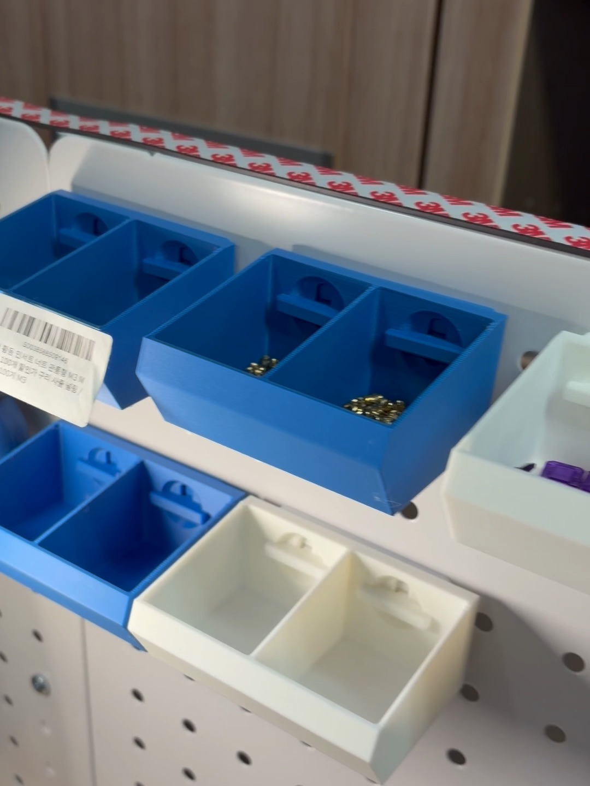

I use a Camel Mount pegboard partition on my desk.
It's a steel panel with round holes punched every 24 mm.

I wanted to hang small trays on it for parts.
I'm sure there are ready-made ones out there.
Daiso probably sells one for 1,000 won.
I just couldn't find one I actually liked.

So I went looking for 3D-printable models...
and almost every pegboard tray model out there is made for IKEA SKÅDIS.

## Every Pegboard Has a Different Hole Shape

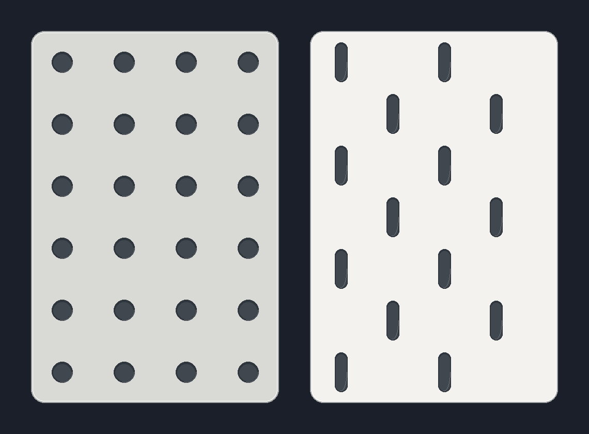

My partition has round holes.
They are 8 mm across, on a 24 mm pitch both horizontally and vertically.

A SKÅDIS board has tall, elongated slots, staggered row by row.
A SKÅDIS tray hangs by pushing a T-clip through one of these slots and turning it 90°.

A round hole has no room for a T-clip.
But there are too many SKÅDIS models to just give up on them.

So I decided to make **a tray that hangs on both boards**.

## One Tray for Both Boards

The back wall of the tray has two slots in the standard SKÅDIS size.
They are 40 mm apart.

- **SKÅDIS board**: just hang it with the T-clips.
- **Round-hole board**: use clips that are a T on the tray side and a threaded post on the board side, and tighten them with wing nuts from behind the board.

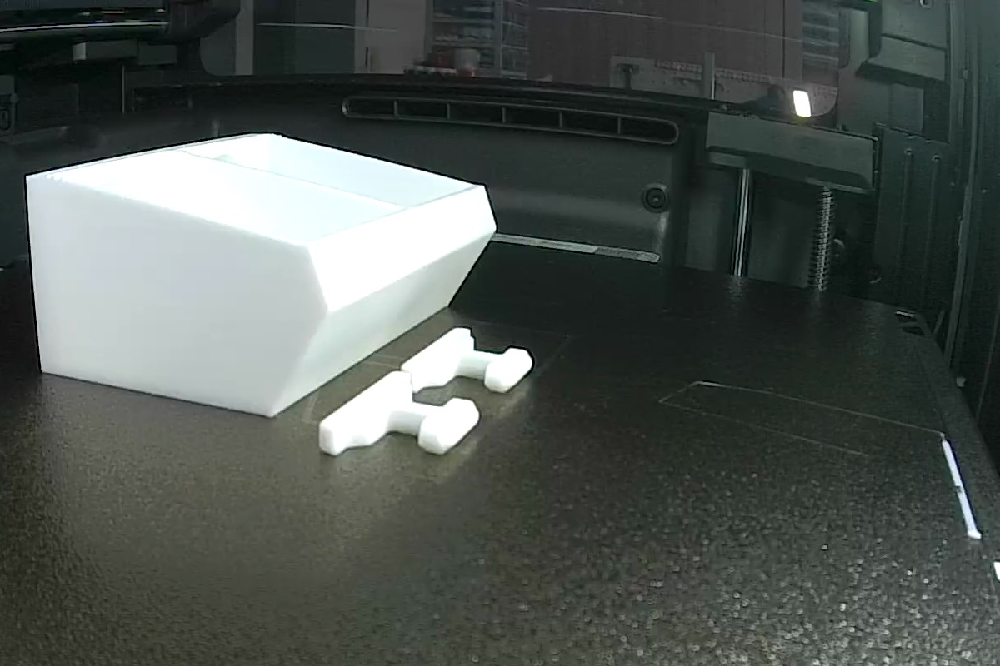

This is the clip for round holes.
Inserting it from inside the tray and turning it 90° to lock is exactly the same as the T-clip,
but a threaded post sticks out on the board side.

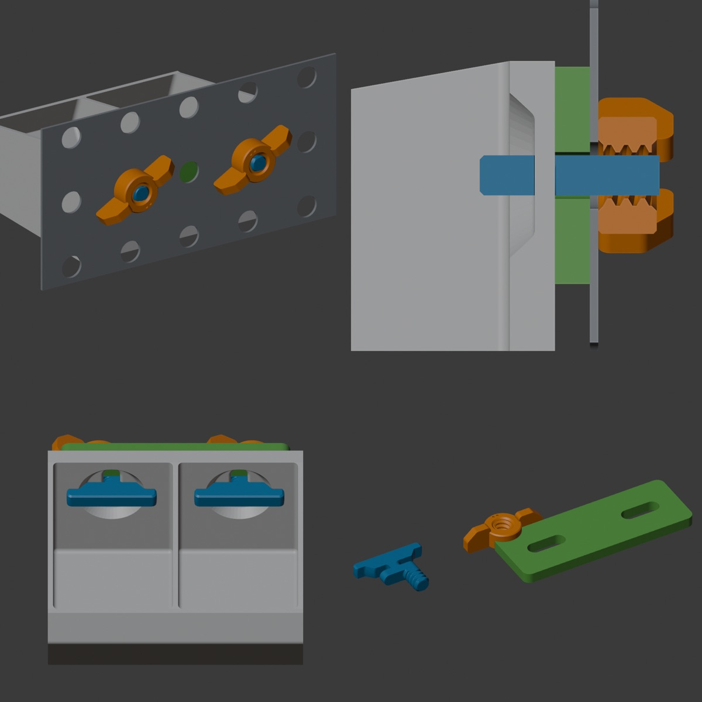

(I don't have a SKÅDIS board, so the round-hole board is the only one I've actually hung it on.)

## Why I Moved the Post 4 mm

Then the spacing didn't line up.
The two slots on the tray are 40 mm apart,
but the partition holes are on a 24 mm pitch, so skipping one hole gives 48 mm.

So I moved each threaded post 4 mm off the clip's center.
Insert the right clip with the post pointing up and the left one with the post pointing down, turn them 90°,
and the posts spread 4 mm outward each, landing exactly 48 mm apart.

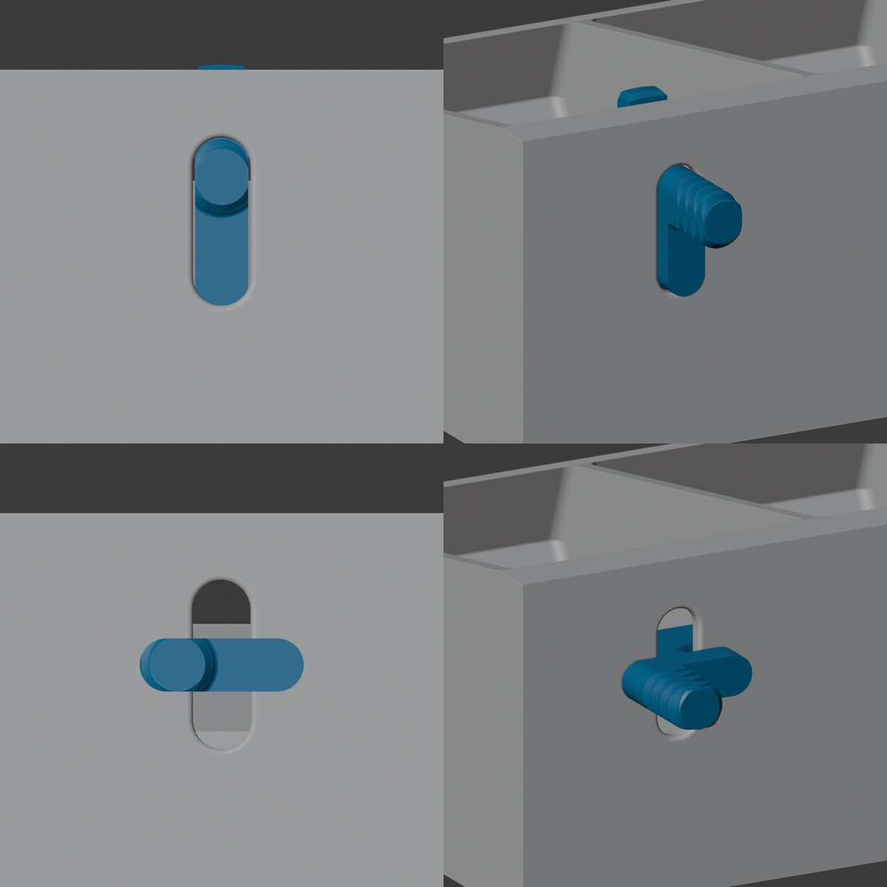

Insert them the other way around and the posts move inward to 32 mm.
If your board has holes 32 mm apart, that works too.

The thread is 6.6 mm in diameter with a 2 mm pitch.
The top and bottom are flattened slightly, so it prints lying down with no supports.
Printed that way, the layers run along the post, so it's less likely to snap.

A 4.2 mm spacer sits between the tray and the board.
It slips over the bent part of the clips and keeps the tray pressed firmly against the board so it doesn't wobble.

## I Printed Three Versions of the Nut

Printed threads come out a bit tight or a bit loose depending on the printer.
So I printed the wing nut in three tolerances.
One, two, or three dots on top tell them apart (0.25 / 0.35 / 0.45 mm clearance).

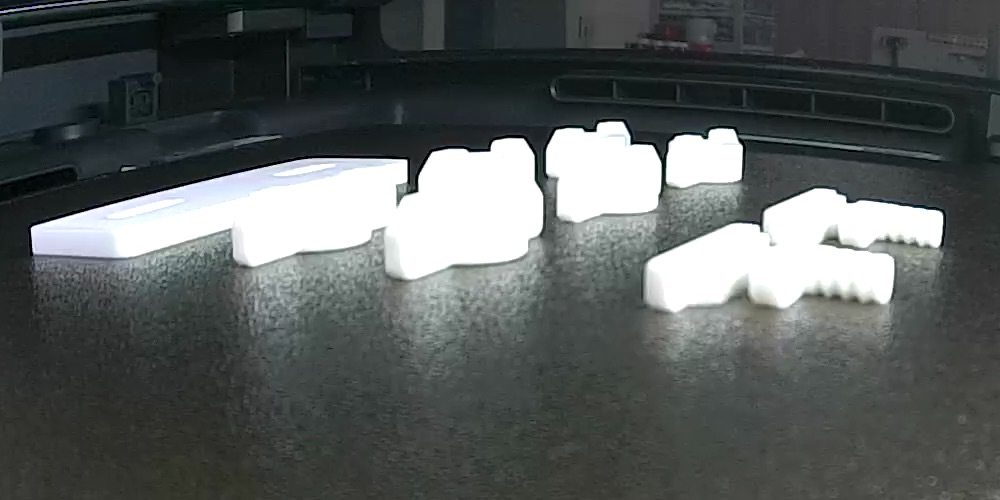

The three-dot nut (0.45 mm) turned the most naturally.
That's the only one I print now.

## Assembly

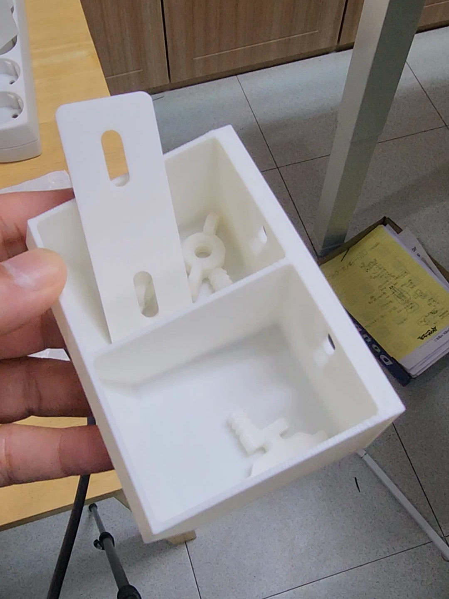

1. From inside the tray, push a clip into each slot. Post up in the right compartment, post down in the left one.
2. Turn each clip 90° clockwise, as seen from inside the tray. Now the clips can't come out.
3. Fit the spacer over the clips on the back of the tray.
4. Push the two posts into two holes in the same row, skipping one hole between them.
5. Tighten the wing nuts by hand from behind the board. Don't overdo it.

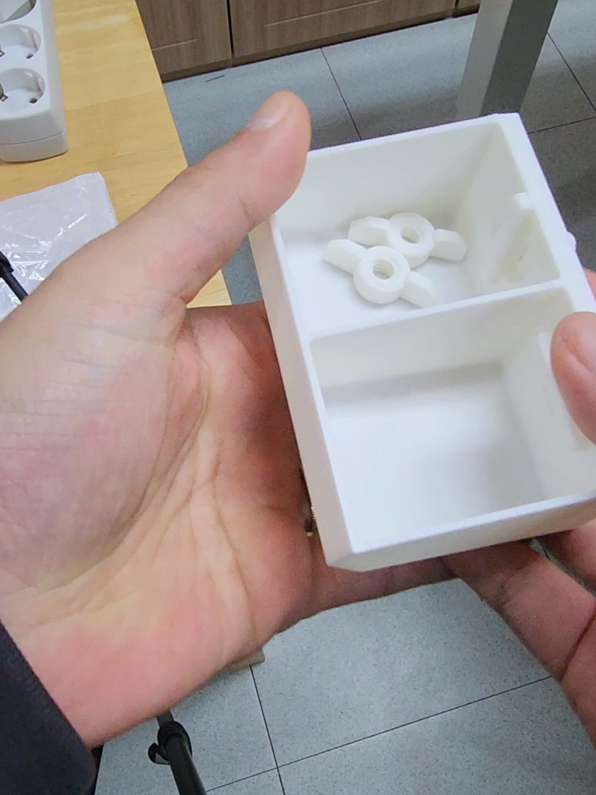

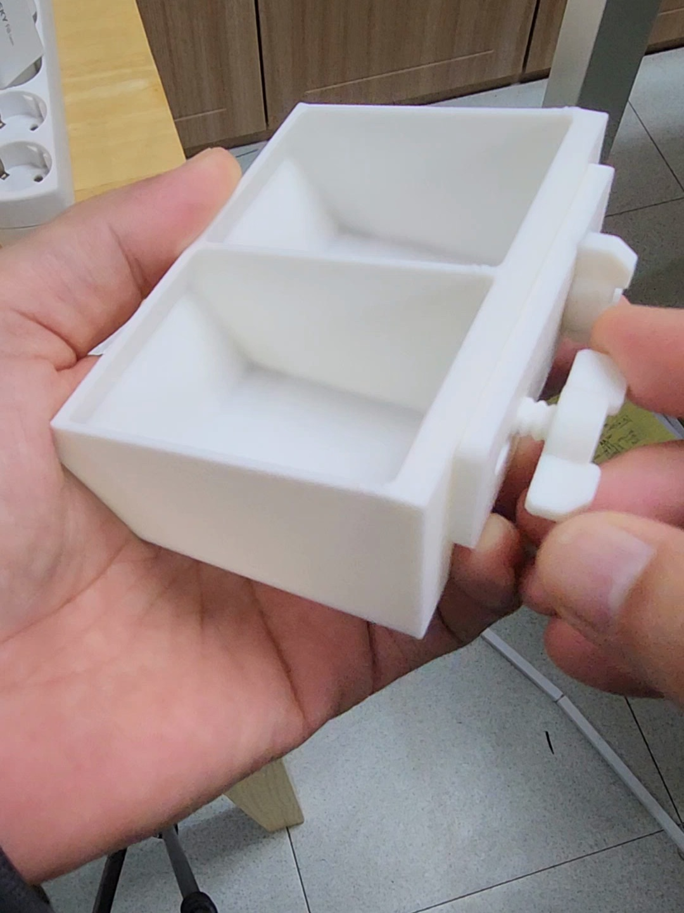

From behind the board, all you see are the wing nuts.

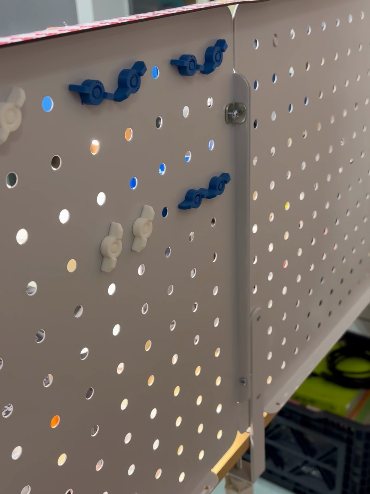

## Side by Side, There Was a 16 mm Gap

I printed several and hung them in a row.

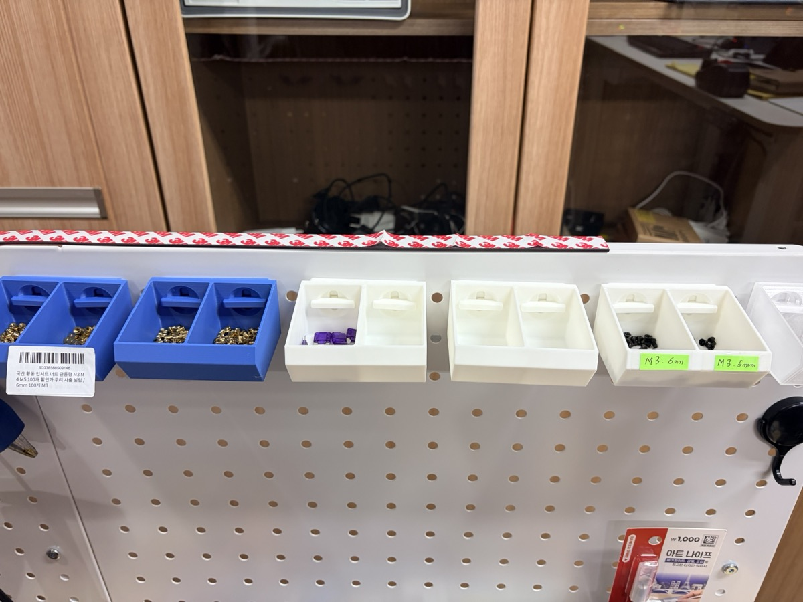

Huh? The gaps looked awkwardly wide.

Once I did the math, it made sense.
The posts are 48 mm apart, so the next tray hangs four holes (96 mm) over.
The tray is 80 mm wide, which leaves 96 − 80 = 16 mm.

So I widened the tray by 7 mm on each side.
94 mm wide, with a 2 mm gap.
Widening by 8 mm would close the gap completely, so I went with 7 mm to leave a little room.

I only stretched the section near the side walls where the shape stays the same along its length.
The slots didn't move, so the same clips, nuts, and spacer still fit, and the SKÅDIS spec is unchanged.
Each compartment also got 7 mm wider, which is a nice bonus.

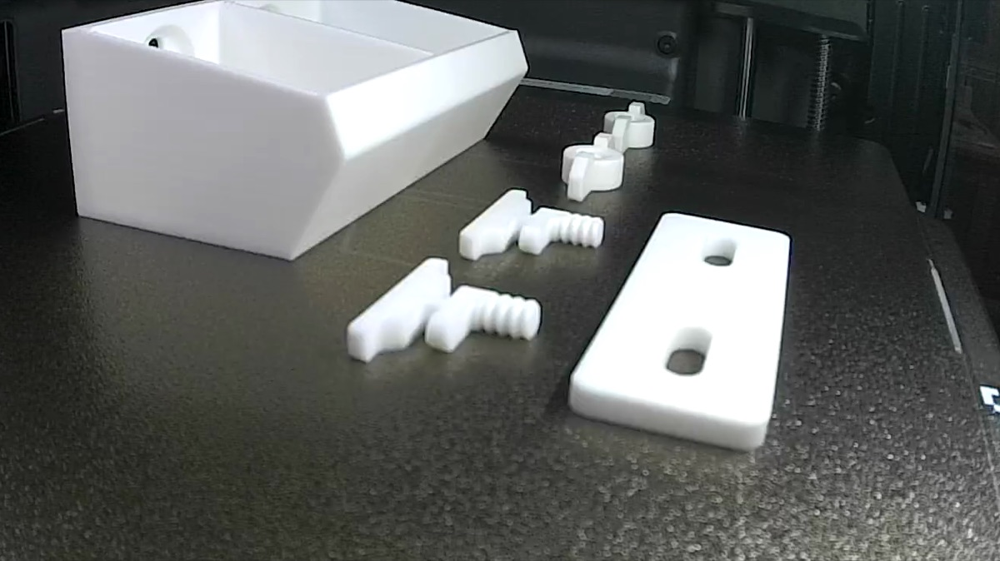

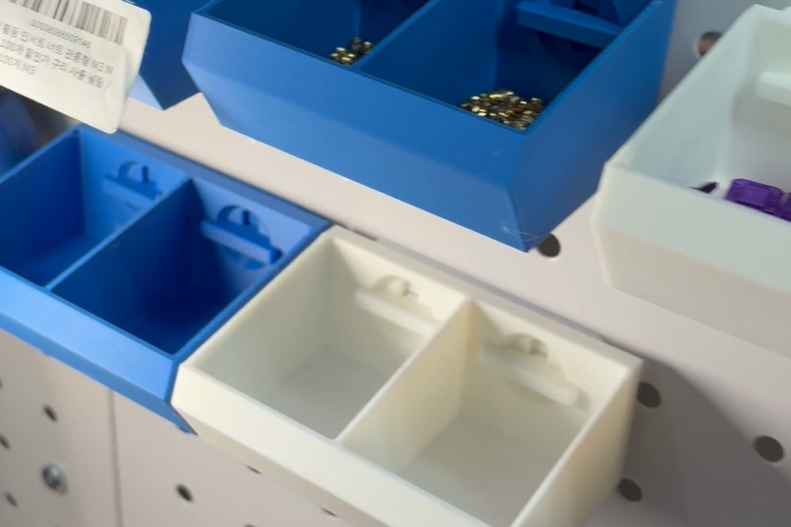

In the photo at the top, too, the top row is the first version (80 mm) and the bottom row is 94 mm.
Side by side, the difference is obvious.

## Takeaways

- One tray hangs on both boards. A T-clip for a SKÅDIS board; a threaded-post clip plus a wing nut for a round-hole board (8 mm holes, 24 mm pitch)
- I matched the 40 mm slot spacing to the 48 mm hole spacing by shifting each post 4 mm sideways
- A 0.45 mm wing nut clearance felt the most natural
- For hanging side by side, make the tray 94 mm wide for a 2 mm gap

These trays don't sit anywhere near heat,
so any material works, PLA or PETG.
I mixed white, blue, and translucent myself.

If you use a similar partition, I'd love to hear how you organize it in the comments.

## Watch the video

The Short covers the print, snapping in the clips, and tightening the wing nuts behind the board.
There is no narration, just the real assembly sounds, and the on-screen text has subtitles in 7 languages.

  <iframe src="https://www.youtube.com/embed/swGOY6G8TA4" title="A Storage Tray That Fits Round-Hole Pegboards and IKEA SKÅDIS" style="position: absolute; inset: 0; width: 100%; height: 100%; border: 0;" allow="accelerometer; autoplay; clipboard-write; encrypted-media; gyroscope; picture-in-picture; web-share" allowfullscreen loading="lazy"></iframe>

- YouTube Shorts: [A Storage Tray That Fits Round-Hole Pegboards and IKEA SKÅDIS](https://www.youtube.com/shorts/swGOY6G8TA4)

## Print info

| Print | Qty | Layer height | Time | Filament |
|---|---|---|---|---|
| Tray set, 94 mm (1 tray + 2 clips + 2 wing nuts + 1 spacer) | 1 set | 0.16 mm | 1 h 49 min | 51.3 g |
| Tray set, 80 mm (first version, same parts) | 1 set | 0.16 mm | 1 h 42 min | 46.9 g |
| Nut tolerance test plate (2 clips + 3 wing nut versions × 2 + 1 spacer) | 1 plate | 0.16 mm | 1 h 2 min | 18.3 g |
| Total (one of each) | | | 4 h 33 min | 116.5 g |

- Printers: Bambu Lab P2S, X2D, and A2L (0.4 mm nozzle). I printed several trays; the table is per set.
- Filament: Bambu PLA Basic, PLA Matte, and PETG (white, blue, translucent)
- Times and filament weights are Bambu Studio slicer estimates (0.16 mm, 2 walls on the tray). The clips were printed with 4 walls and 100 % infill, the nuts with 4 walls. Actual print times vary by printer.

## Sources

- Tray model: IKEA SKADIS TRAY by Gr3dstampaidee on MakerWorld
- Board-side clip (threaded post), wing nuts, and spacer: my own design
