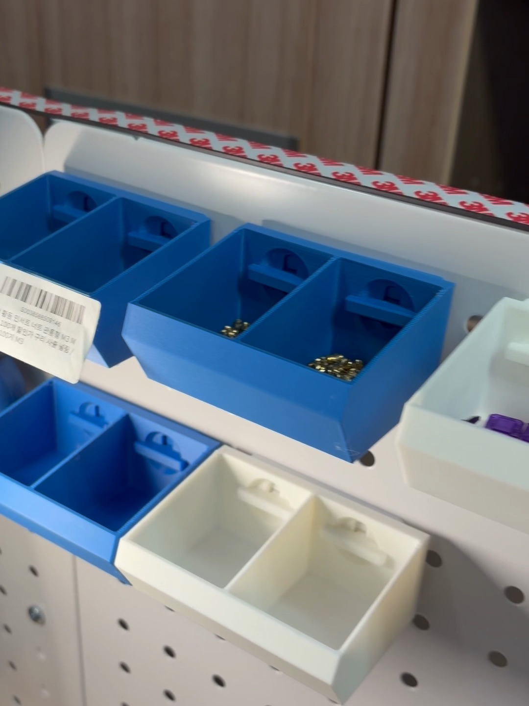

机でCamel Mount（カメルマウント）の有孔パーティションを使っています。
鉄板に丸い穴が24 mm間隔で開いているパーティションです。

ここに小さな部品を入れるトレイを付けたいと思いました。
既製品なら探せばあると思います。
ダイソーにも1,000ウォンくらいで売っていそうです。
ただ、自分の好みに合うものは見つかりませんでした。

そこで3Dプリンター用のモデルを探したのですが……
有孔ボード用のトレイのモデルは、ほとんどがイケアのスコーディス（SKÅDIS）用なんですね。

## ボードごとに穴の形が違う

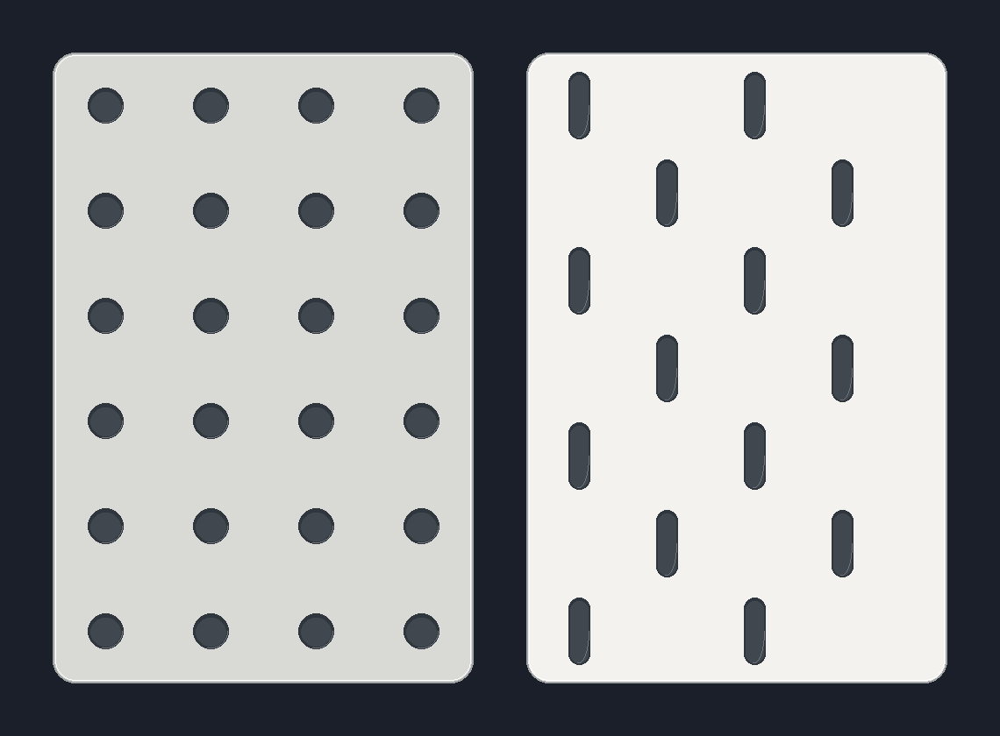

私のパーティションは穴が丸いです。
直径8 mmの穴が、縦横24 mm間隔で開いています。

スコーディスのボードは穴が縦に細長く、列ごとに互い違いになっています。
スコーディス用のトレイは、この細長い穴にT字のクリップを差し込み、90°回して掛けます。

丸い穴には、Tクリップを差し込む場所がありません。
かといって、スコーディス用のモデルはあまりに多く、諦めるのはもったいないです。

そこで、**どちらのボードにも掛かるトレイ**を作ることにしました。

## 1つのトレイで両方のボードに

トレイの背板には、スコーディスと同じ規格のスロットが2つあります。
スロットの間隔は40 mmです。

- **スコーディスのボード**：Tクリップでそのまま掛けます。
- **丸穴のボード**：トレイ側はT字、ボード側はオネジの柱になっているクリップを使い、ボードの裏から蝶ナットで締めます。

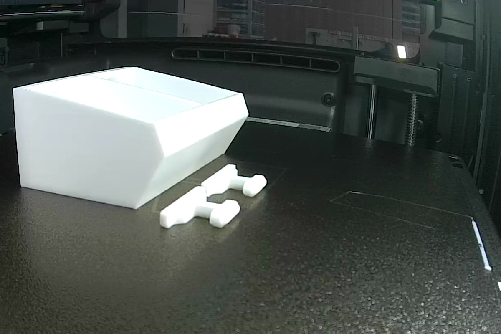

丸穴用のクリップはこのような形です。
トレイの内側からスロットに差し込み、90°回して固定するのはTクリップと同じで、
ボード側にはネジの柱が出ています。

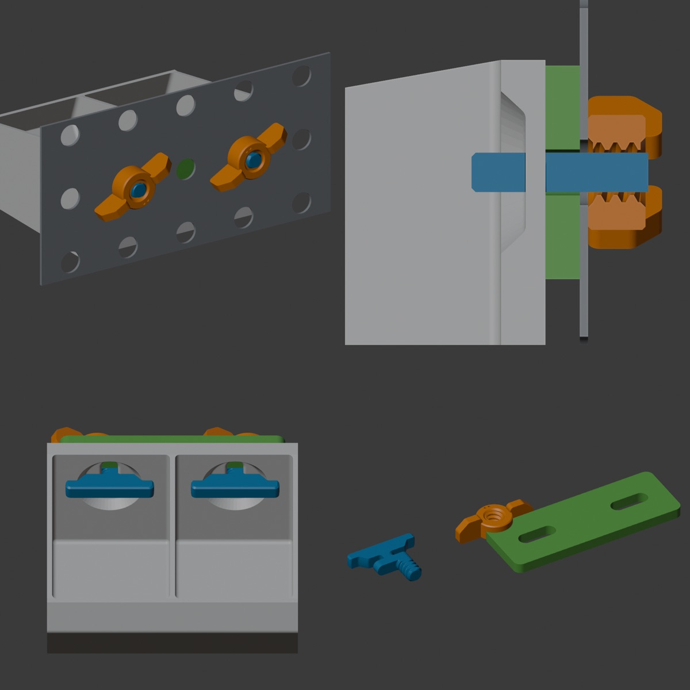

（私はスコーディスのボードを持っていないので、実際に掛けてみたのは丸穴のボードだけです。）

## 柱を4 mmずらした理由

ところが、間隔が合いませんでした。
トレイのスロット2つは40 mm離れていますが、
パーティションの穴は24 mm間隔なので、1つ飛ばすと48 mmになります。

そこでネジの柱をクリップの中心から4 mm横にずらしました。
右のクリップは柱が上、左のクリップは柱が下になるように差し込んで90°回すと、
2本の柱が外側へ4 mmずつ広がり、ちょうど48 mmになります。

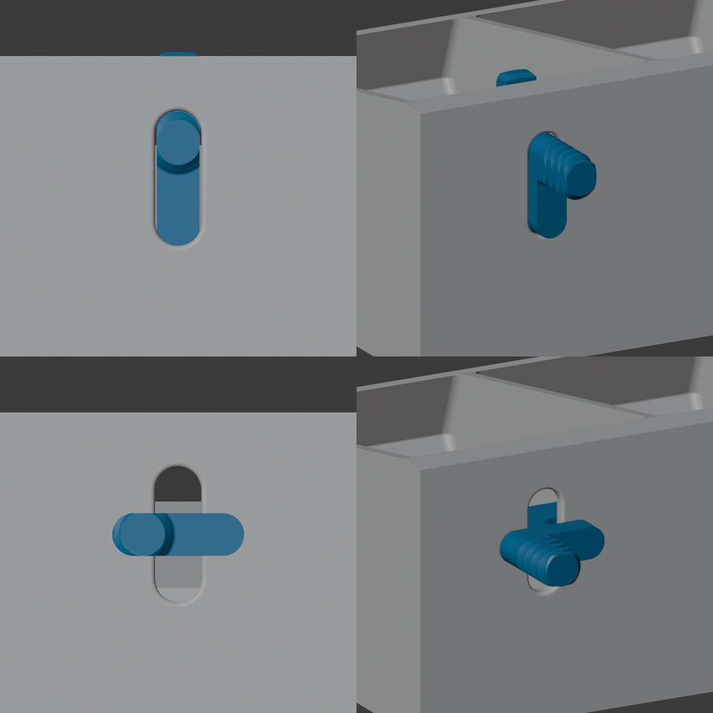

逆向きに差し込むと内側に寄って32 mmになります。
穴の間隔が32 mmのボードなら、そう使えばいいです。

ネジは直径6.6 mm、ピッチ2 mmです。
上下を少し削ってあるので、寝かせて出力してもサポートは要りません。
寝かせて出力すると積層の向きが柱と平行になるので、ポキッと折れる心配も減ります。

トレイとボードの間には、厚さ4.2 mmのスペーサーを挟みます。
クリップの曲がった部分にかぶせる板で、トレイがボードにしっかり密着してぐらつかないように支えてくれます。

## ナットは3種類出力してみた

出力したネジは、プリンターによって少しきつかったりゆるかったりします。
そこで蝶ナットを、公差だけを変えて3種類出力しました。
上面に点を1・2・3個付けて区別しています（すき間0.25 / 0.35 / 0.45 mm）。

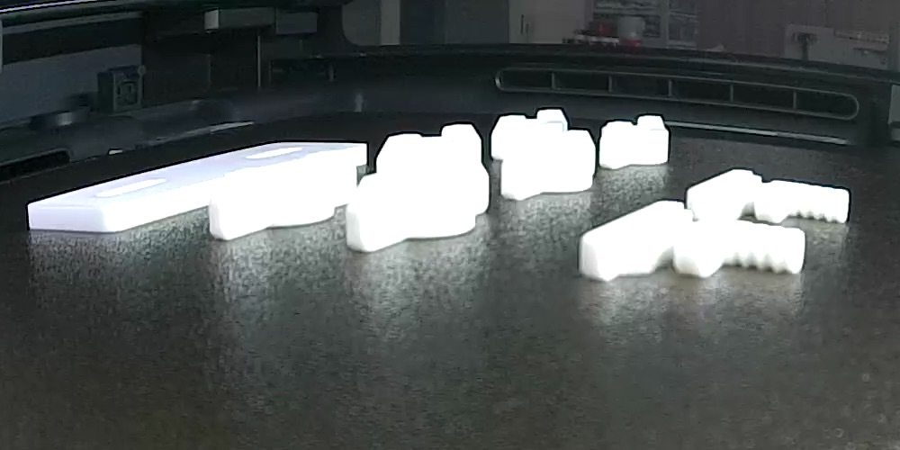

回してみると、点3つ（0.45 mm）が一番自然に回りました。
それからはこれだけを出力しています。

## 取り付けの手順

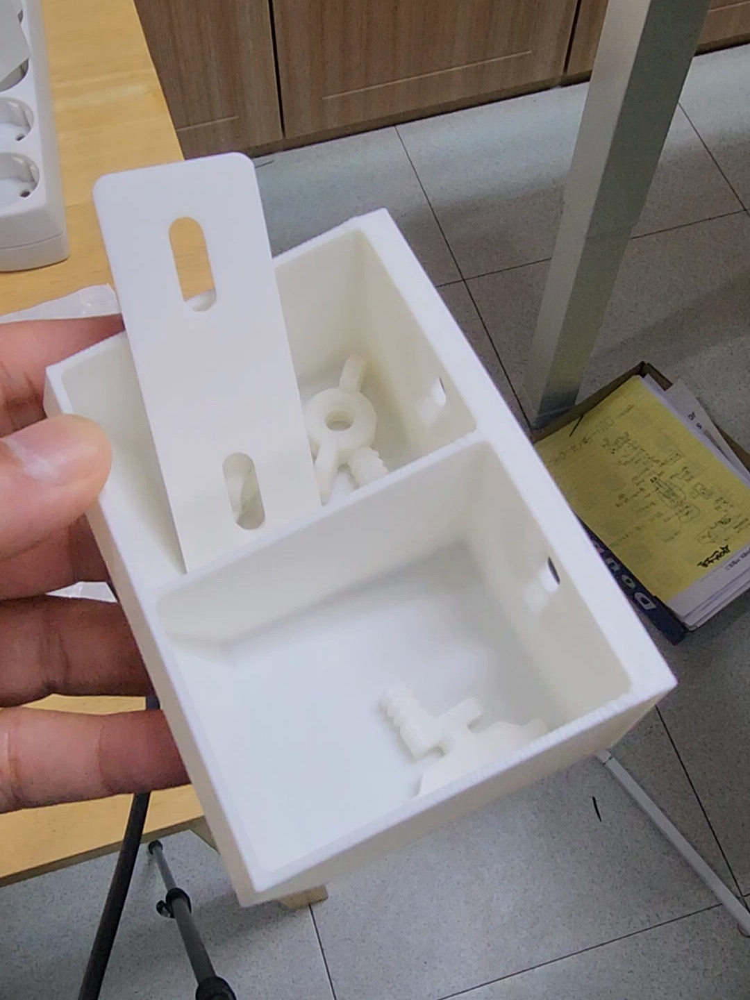

1. トレイの内側からクリップをスロットに差し込みます。右の仕切りは柱が上、左の仕切りは柱が下になるようにします。
2. トレイの内側から見て時計回りに90°回します。これでクリップは抜けません。
3. トレイの後ろからスペーサーをかぶせます。
4. 2本の柱を、同じ列で1つ飛ばした2つの穴に差し込みます。
5. ボードの裏から蝶ナットを手で締めます。締めすぎないようにします。

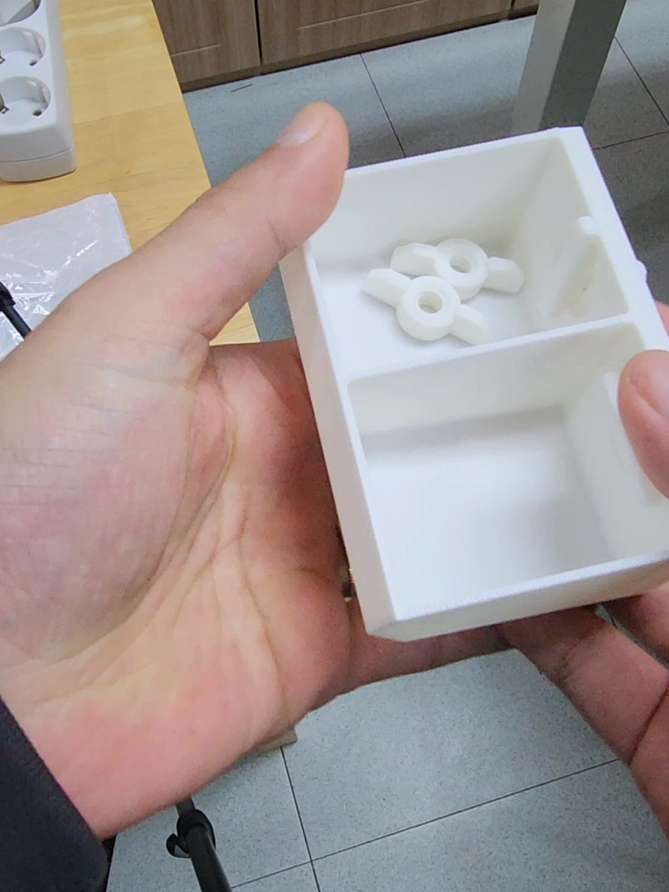

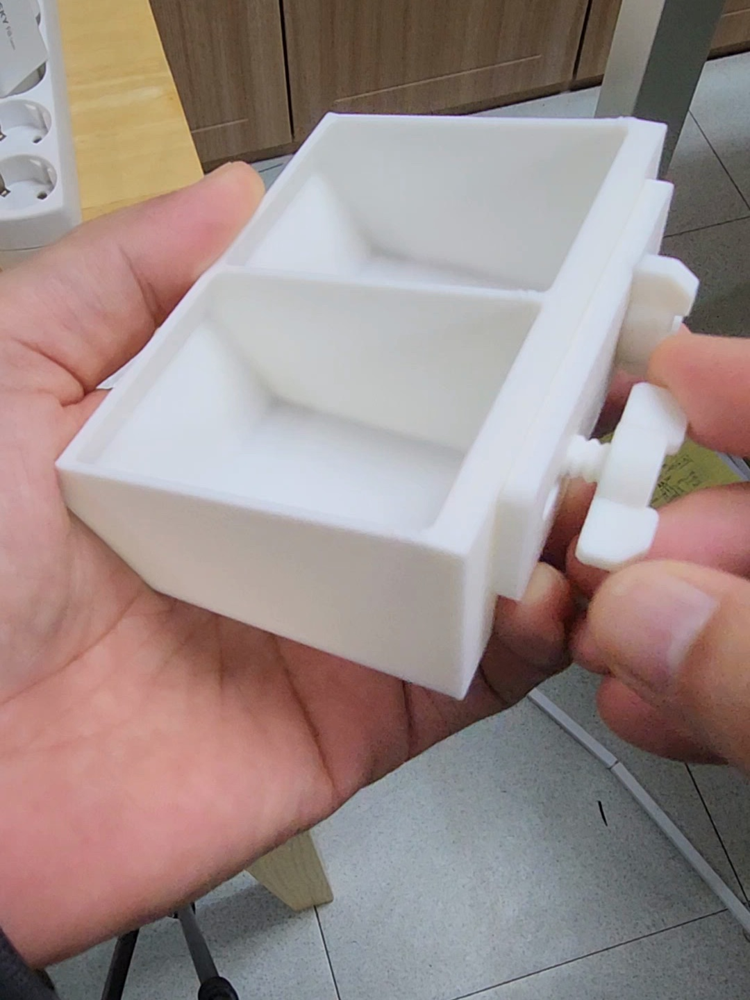

ボードの裏から見ると、蝶ナットだけが見えます。

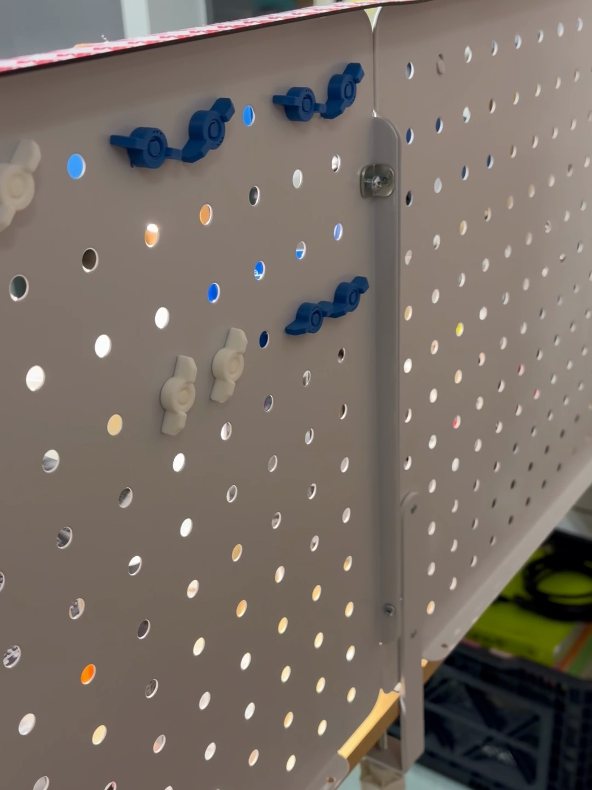

## 並べて掛けたら16 mmのすき間

いくつか出力して並べて掛けてみました。

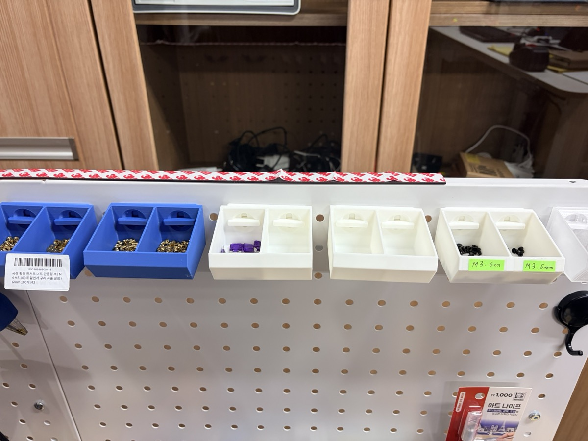

あれ？ 間がすかすかです。

計算してみると当然でした。
柱の間隔が48 mmなので、隣のトレイは穴4つ分（96 mm）横に掛かります。
トレイの幅が80 mmなので、96 − 80 = 16 mm余るわけです。

そこでトレイを左右に7 mmずつ広げました。
幅94 mmで、すき間は2 mmです。
8 mmずつ広げるとすき間が0になるので、少し余裕を残して7 mmにしました。

広げたのは側壁の近く、形が同じまま続いている部分だけです。
スロットの位置は変わらないので、クリップ・ナット・スペーサーは最初のものがそのまま合い、スコーディスの規格もそのままです。
仕切りの内側が7 mmずつ広くなったのはおまけです。

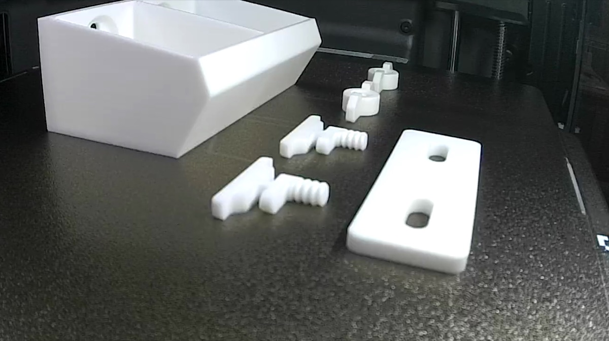

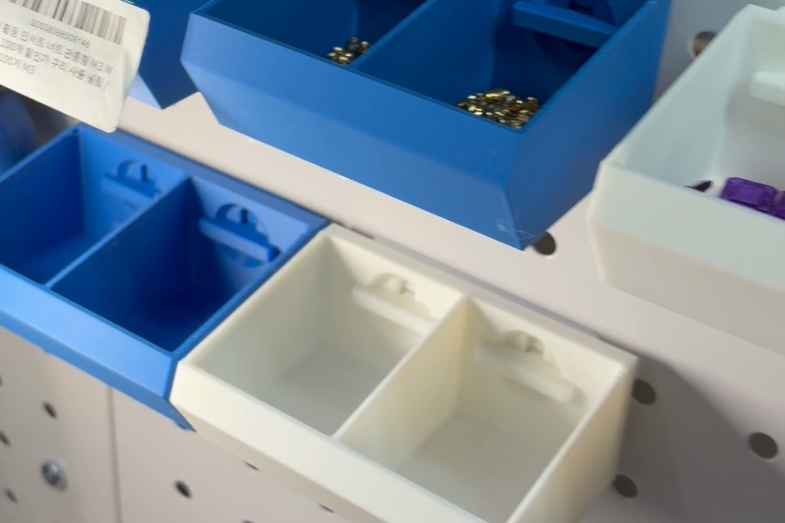

一番上の写真も、上の段が最初の版（幅80）、下の段が幅94です。
並べてみると違いがはっきり分かります。

## まとめ

- 1つのトレイで両方のボードに掛けられる。スコーディスのボードはTクリップ、丸穴のボード（直径8 mm、間隔24 mm）はネジ付きクリップ + 蝶ナット
- スロット間隔40 mmと穴の間隔48 mmは、柱を4 mmずつ横にずらして合わせた
- 蝶ナットの公差は0.45 mmが一番自然だった
- 並べて掛けるなら、トレイの幅は94 mmで、すき間は2 mm

熱がかかる場所に置くものではないので、
PLAでもPETGでも、どの素材で出力しても大丈夫です。
私も白・青・半透明を混ぜて出力しました。

似たようなパーティションを使っている方がいたら、どう整理しているかコメントで教えてください。

## 動画で見る

出力からクリップの取り付け、ボードの裏で蝶ナットを締めるところまでをショート動画にまとめました。
ナレーションはなく、実際の組み立ての音だけです。画面の文字は7言語の字幕で見られます。

  <iframe src="https://www.youtube.com/embed/swGOY6G8TA4" title="丸穴の有孔ボードにもイケアのスコーディスにも掛けられる収納トレイ" style="position: absolute; inset: 0; width: 100%; height: 100%; border: 0;" allow="accelerometer; autoplay; clipboard-write; encrypted-media; gyroscope; picture-in-picture; web-share" allowfullscreen loading="lazy"></iframe>

- YouTubeショート: [丸穴の有孔ボードにもイケアのスコーディスにも掛けられる収納トレイ](https://www.youtube.com/shorts/swGOY6G8TA4)

## 出力情報

| 出力物 | 個数 | 積層ピッチ | 時間 | フィラメント |
|---|---|---|---|---|
| トレイセット 幅94（トレイ1 + クリップ2 + 蝶ナット2 + スペーサー1） | 1セット | 0.16 mm | 1時間49分 | 51.3 g |
| トレイセット 幅80（最初の版、同じ構成） | 1セット | 0.16 mm | 1時間42分 | 46.9 g |
| ナットの公差テストプレート（クリップ2 + 蝶ナット3種 × 2 + スペーサー1） | 1枚 | 0.16 mm | 1時間2分 | 18.3 g |
| 合計（各1回ずつ） | | | 4時間33分 | 116.5 g |

- プリンター：Bambu Lab P2S・X2D・A2L（0.4 mmノズル）。トレイはいくつも出力しましたが、表は1セットあたりの値です。
- フィラメント：Bambu PLA Basic・PLA Matte・PETG（白・青・半透明）
- 時間とフィラメントは、Bambu Studioでスライスした予測値です（0.16 mm、トレイの壁2層）。クリップは壁4層・インフィル100 %、ナットは壁4層で出力しました。実際の出力時間はプリンターによって異なります。

## 出典

- トレイのモデル：MakerWorldのGr3dstampaideeさんのIKEA SKADIS TRAY
- ボード側のクリップ（オネジの柱）・蝶ナット・スペーサー：自分で設計
