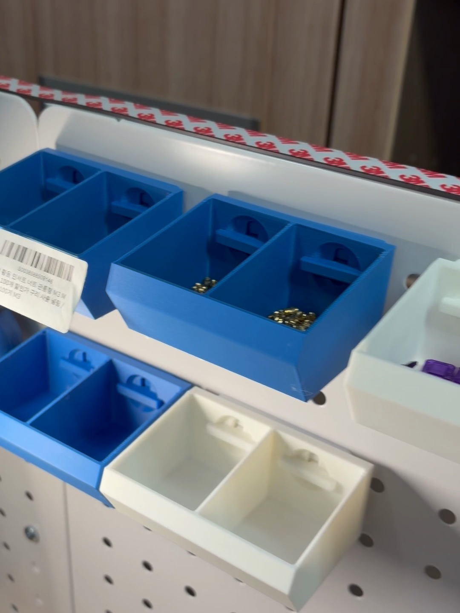

책상에 카멜마운트 타공 파티션을 쓰고 있다.
철판에 동그란 구멍이 24 mm 간격으로 뚫린 그 파티션이다.

여기에 작은 부품 넣을 트레이를 달고 싶었다.
기성품이야 찾으면 있을 거다.
다이소 가면 천 원짜리도 있을 거고 ㅋㅋ
근데 내 취향에 맞는 건 못 찾았다.

그래서 3D 프린터용 모델을 뒤졌는데...
타공판 트레이 모델은 거의 다 이케아 스카디스(SKÅDIS)용이더라 ㅠㅠ

## 타공판마다 구멍 모양이 다르다

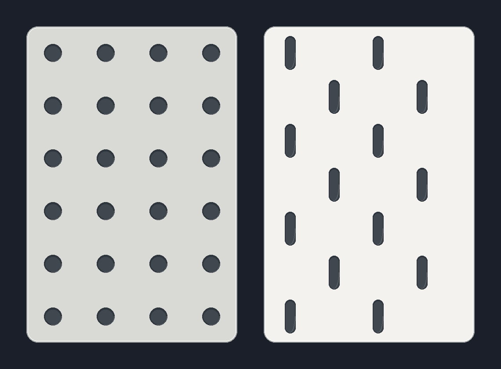

내 파티션은 구멍이 동그랗다.
지름 8 mm 구멍이 가로세로 24 mm 간격으로 나 있다.

스카디스 판은 구멍이 세로로 길쭉하고, 줄마다 엇갈려 있다.
스카디스용 트레이는 이 길쭉한 구멍에 T자 클립을 끼우고 90° 돌려서 건다.

동그란 구멍에는 T자 클립이 들어갈 데가 없다.
그렇다고 스카디스용을 버리기엔 모델이 너무 많다.

그래서 **두 판에 다 걸리는 트레이**를 만들기로 했다.

## 트레이 하나로 두 판 다

트레이 뒤판에는 스카디스와 같은 규격의 슬롯이 두 개 있다.
슬롯 사이는 40 mm다.

- **스카디스 판**: T자 클립으로 그냥 건다.
- **동그란 구멍 판**: 트레이 쪽은 T자, 판 쪽은 수나사 기둥인 클립을 쓰고, 판 뒤에서 날개 너트로 조인다.

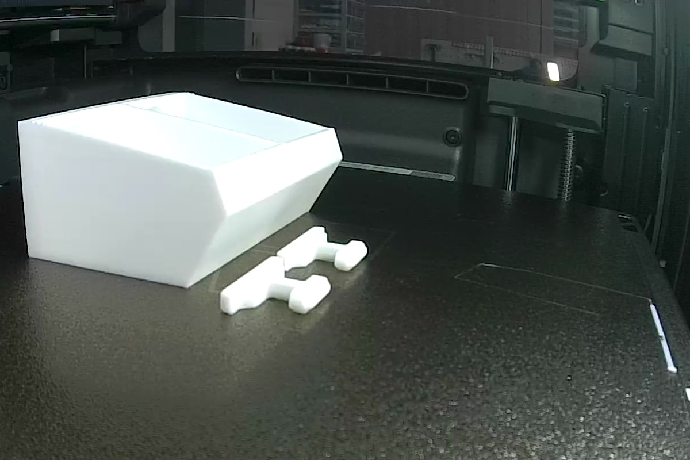

동그란 구멍용 클립은 이렇게 생겼다.
트레이 안쪽에서 슬롯에 끼우고 90° 돌려 잠그는 건 T자 클립과 똑같고,
판 쪽으로는 나사 기둥이 나온다.

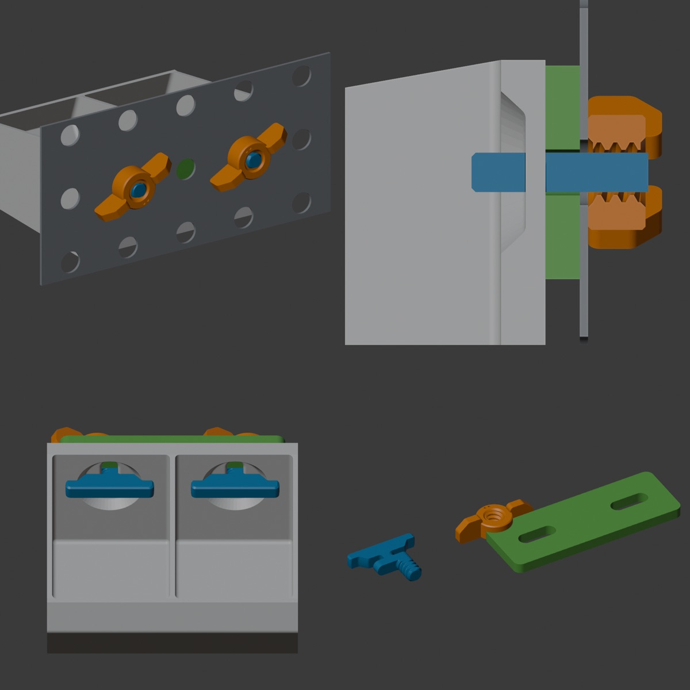

(나는 스카디스 판이 없어서, 직접 걸어 본 건 동그란 구멍 판뿐이다.)

## 기둥을 4 mm 옮긴 이유

근데 간격이 안 맞더라.
트레이 슬롯 두 개는 40 mm 떨어져 있는데
파티션 구멍은 24 mm 간격이라 한 칸 건너뛰면 48 mm다.

그래서 나사 기둥을 클립 중심에서 4 mm 옆으로 옮겼다.
오른쪽 클립은 기둥이 위로, 왼쪽 클립은 아래로 가게 넣고 90° 돌리면
두 기둥이 바깥쪽으로 4 mm씩 벌어져서 딱 48 mm가 된다.

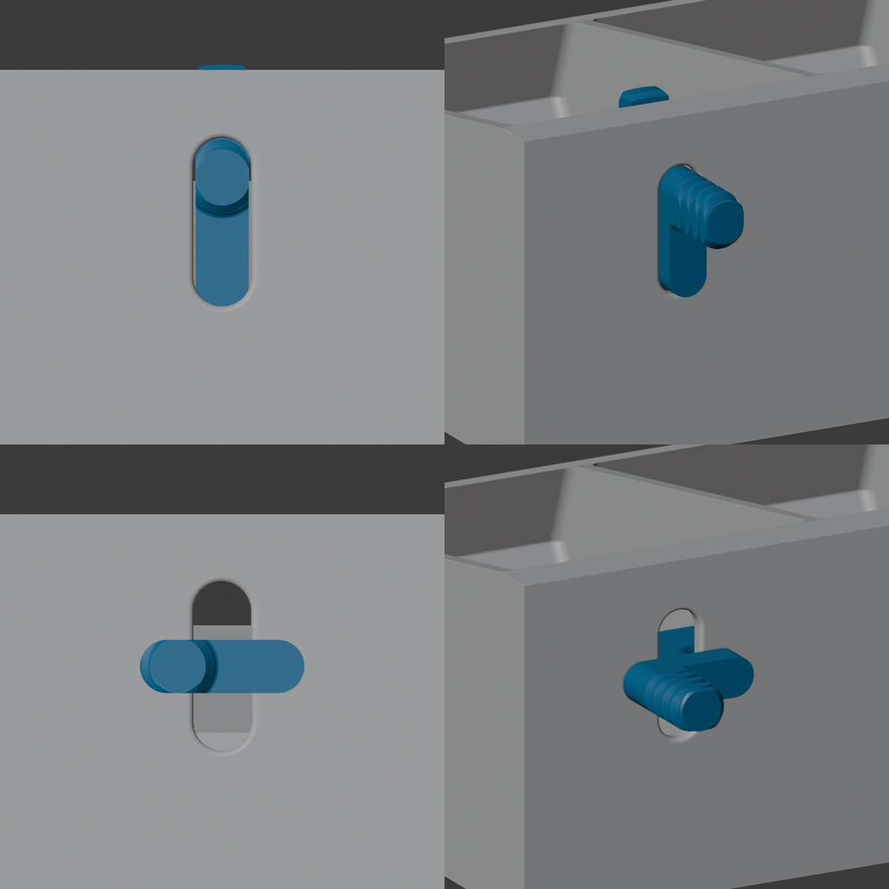

반대로 넣으면 안쪽으로 모여서 32 mm가 된다.
구멍 간격이 32 mm인 판이라면 그렇게 쓰면 된다.

나사는 지름 6.6 mm, 피치 2 mm다.
위아래를 살짝 깎아 둬서 눕혀서 출력해도 서포트가 필요 없다.
눕혀 뽑으면 층 방향이 기둥과 나란해서 똑 부러질 걱정도 덜하다.

트레이와 판 사이에는 두께 4.2 mm 스페이서를 끼운다.
클립의 꺾인 부분에 씌우는 판인데, 트레이가 판에 단단히 붙어 흔들리지 않게 잡아 준다.

## 너트는 세 가지로 뽑아 봤다

출력한 나사는 프린터마다 조금씩 빡빡하거나 헐겁다.
그래서 날개 너트를 공차만 다르게 세 종류로 뽑았다.
윗면에 점을 1·2·3개 찍어서 구분했다(틈 0.25 / 0.35 / 0.45 mm).

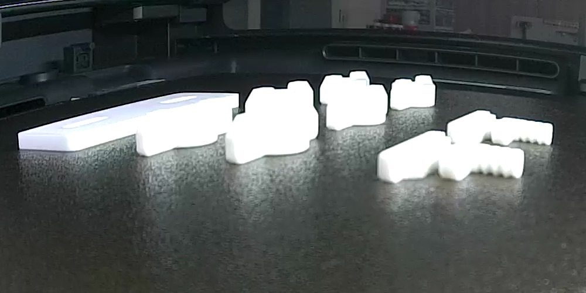

돌려 보니 점 3개짜리(0.45 mm)가 제일 자연스럽게 돌아가더라.
그 뒤로는 이걸로만 뽑는다.

## 끼우는 순서

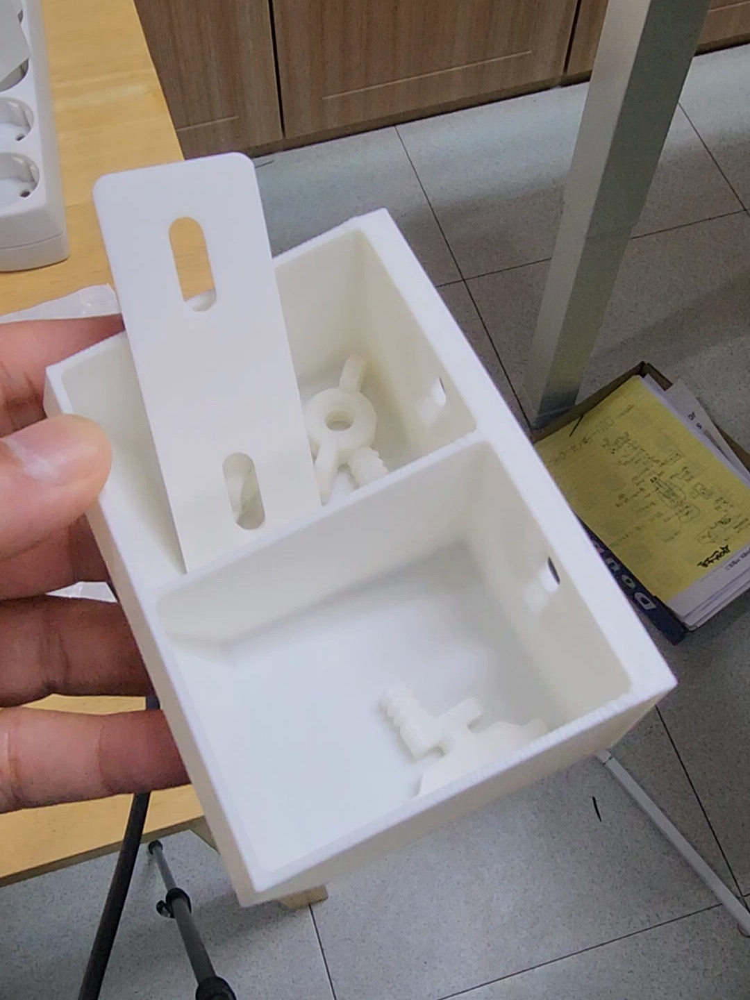

1. 트레이 안쪽에서 클립을 슬롯에 넣는다. 오른쪽 칸은 기둥이 위로, 왼쪽 칸은 아래로 가게 넣는다.
2. 트레이 안쪽에서 볼 때 시계 방향으로 90° 돌린다. 이러면 클립이 빠지지 않는다.
3. 트레이 뒤에서 스페이서를 씌운다.
4. 기둥 두 개를 같은 줄에서 한 칸 건너뛴 두 구멍에 꽂는다.
5. 판 뒤에서 날개 너트를 손으로 조인다. 너무 세게 조이지는 않는다.

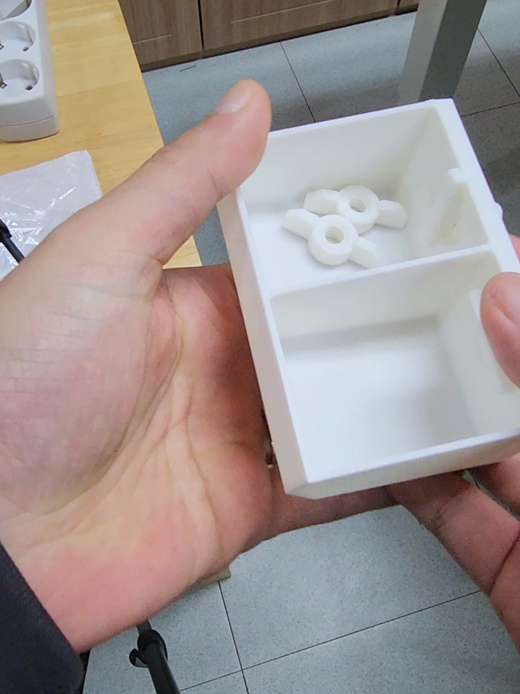

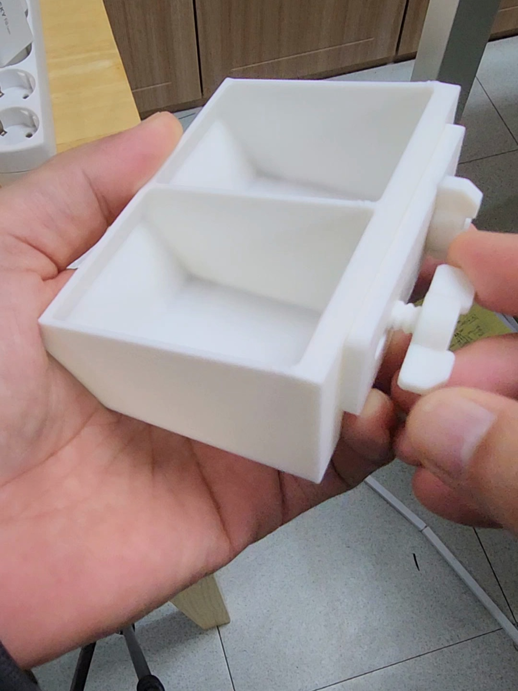

판 뒤에서 보면 날개 너트만 보인다.

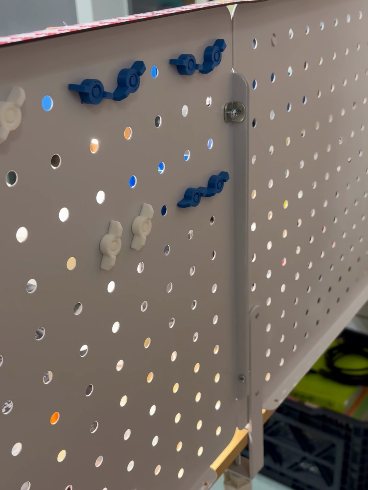

## 나란히 걸었더니 틈이 16 mm

여러 개 뽑아서 나란히 걸어 봤다.

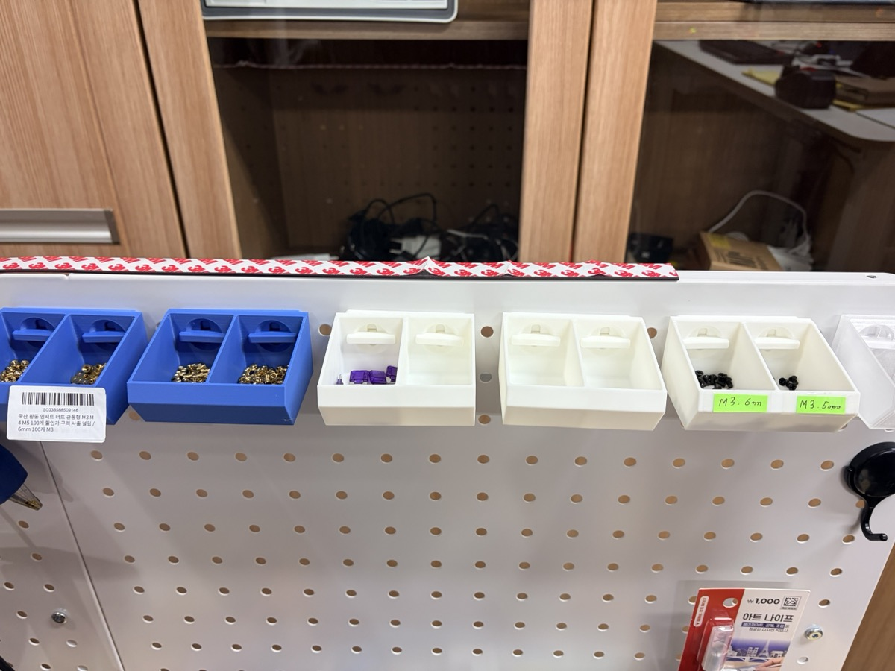

어라? 사이가 휑하다.

계산해 보니 당연했다.
기둥 간격이 48 mm라서 옆 트레이는 구멍 네 칸(96 mm) 옆에 걸린다.
트레이 폭이 80 mm니까 96 − 80 = 16 mm가 남는 거다.

그래서 트레이를 좌우로 7 mm씩 늘렸다.
폭 94 mm, 틈은 2 mm.
8 mm씩 늘리면 틈이 0이 되는데, 살짝 여유를 두고 7 mm로 했다.

늘린 건 옆벽 근처, 모양이 똑같이 이어지는 구간뿐이다.
슬롯 위치는 그대로라서 클립·너트·스페이서는 처음 것 그대로 맞고, 스카디스 규격도 그대로다.
칸 안쪽이 7 mm씩 넓어진 건 덤이다 ㅎㅎ

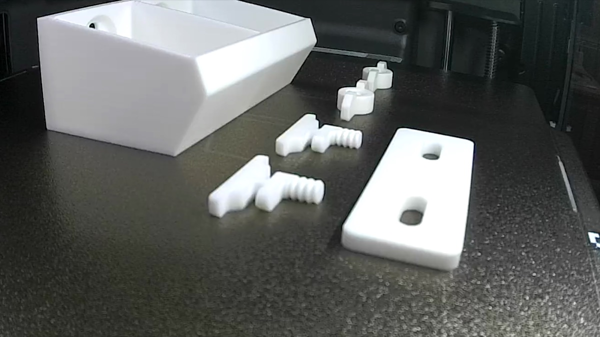

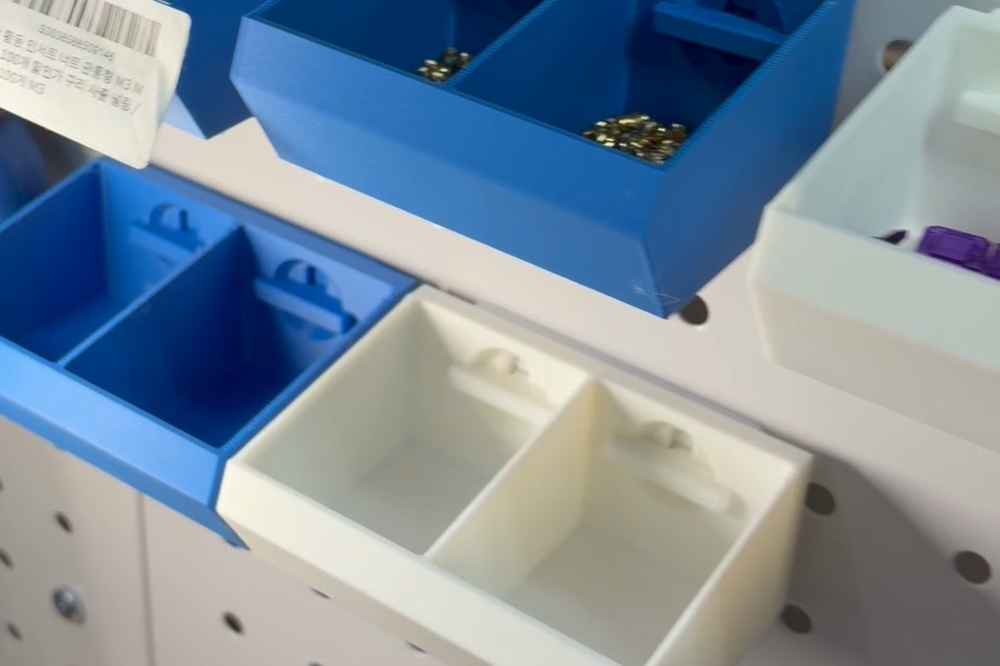

맨 위 사진도 윗줄이 처음 버전(폭 80), 아랫줄이 폭 94다.
나란히 놓고 보니 차이가 확실하다.

## 정리하면

- 트레이 하나로 두 판에 다 건다. 스카디스 판은 T자 클립, 동그란 구멍 판(지름 8 mm, 간격 24 mm)은 나사 클립 + 날개 너트
- 슬롯 간격 40 mm와 구멍 간격 48 mm는 기둥을 4 mm씩 옆으로 옮겨서 맞췄다
- 날개 너트 공차는 0.45 mm가 제일 자연스러웠다
- 나란히 걸 거면 트레이 폭 94 mm, 틈은 2 mm

열 받는 자리에 두는 물건이 아니라서
PLA든 PETG든 아무 소재로 뽑아도 괜찮다.
나도 흰색·파랑·반투명을 섞어서 뽑았다.

비슷한 파티션 쓰시는 분들은 어떻게 정리하시는지 댓글로 알려 주세요 ㅎㅎ

## 영상으로 보기

출력부터 클립 끼우기, 판 뒤에서 날개 너트 조이기까지 쇼츠로 담았다.
말 없이 실제 조립 소리만 넣었고, 화면 글자는 7개 언어 자막으로 볼 수 있다.

  <iframe src="https://www.youtube.com/embed/swGOY6G8TA4" title="동그란 구멍 타공판도, 이케아 스카디스도 걸리는 수납 트레이" style="position: absolute; inset: 0; width: 100%; height: 100%; border: 0;" allow="accelerometer; autoplay; clipboard-write; encrypted-media; gyroscope; picture-in-picture; web-share" allowfullscreen loading="lazy"></iframe>

- 유튜브 쇼츠: [동그란 구멍 타공판도, 이케아 스카디스도 걸리는 수납 트레이](https://www.youtube.com/shorts/swGOY6G8TA4)

## 출력 정보

| 출력물 | 개수 | 층 높이 | 시간 | 필라멘트 |
|---|---|---|---|---|
| 트레이 세트 폭 94 (트레이 1 + 클립 2 + 날개 너트 2 + 스페이서 1) | 1세트 | 0.16 mm | 1시간 49분 | 51.3 g |
| 트레이 세트 폭 80 (처음 버전, 같은 구성) | 1세트 | 0.16 mm | 1시간 42분 | 46.9 g |
| 너트 공차 시험판 (클립 2 + 날개 너트 3종 × 2 + 스페이서 1) | 1판 | 0.16 mm | 1시간 2분 | 18.3 g |
| 합계 (각 1번씩) | | | 4시간 33분 | 116.5 g |

- 프린터: Bambu Lab P2S · X2D · A2L (0.4 mm 노즐). 트레이는 여러 개 뽑았고, 표는 한 세트 기준이다.
- 필라멘트: Bambu PLA Basic · PLA Matte · PETG (흰색 · 파랑 · 반투명)
- 시간과 필라멘트는 Bambu Studio에서 슬라이스한 예상값이다(0.16 mm, 트레이 벽 2겹). 클립은 벽 4겹에 채움 100 %, 너트는 벽 4겹으로 뽑았다. 실제 출력 시간은 프린터마다 다르다.

## 출처

- 트레이 모델: MakerWorld Gr3dstampaidee 님의 IKEA SKADIS TRAY
- 판 쪽 클립(수나사 기둥)·날개 너트·스페이서: 직접 설계
